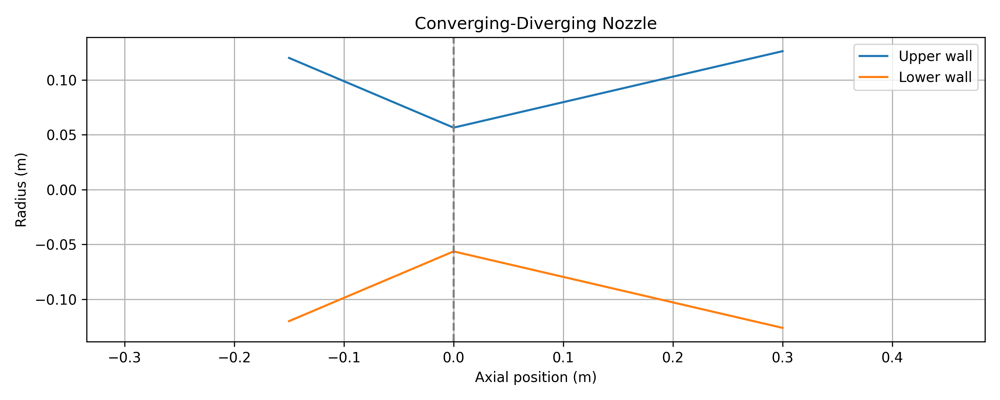
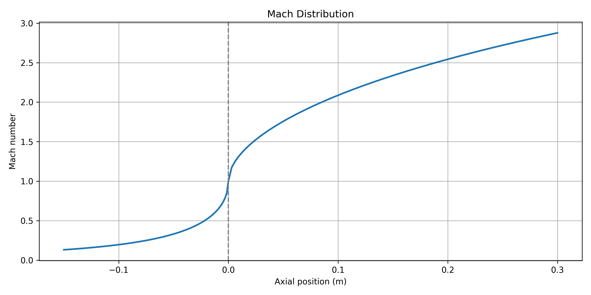
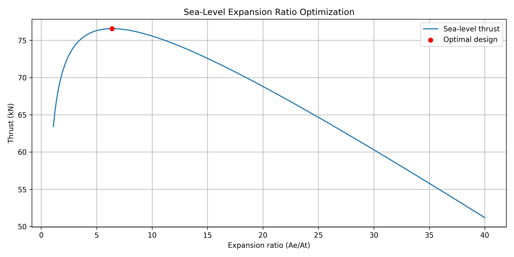
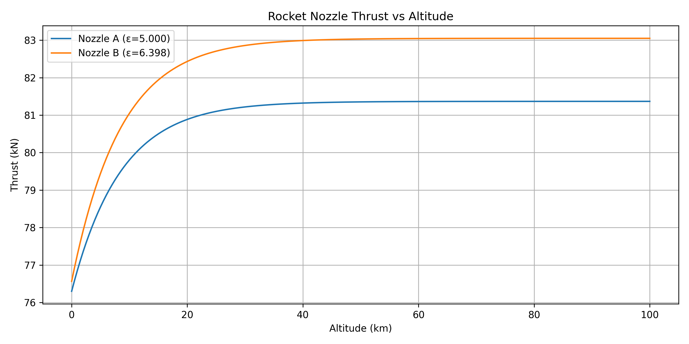

# Rocket Nozzle Performance Simulator

A Python-based engineering simulator for analyzing ideal compressible flow through a converging-diverging rocket nozzle.

## Overview

This project models steady, quasi-one-dimensional, isentropic gas flow through a rocket nozzle. It calculates flow properties along the nozzle, evaluates thrust and specific impulse under different ambient conditions, and numerically determines the expansion ratio that maximizes ideal sea-level thrust for fixed chamber conditions and throat area.

The project was developed to apply compressible-flow and rocket-propulsion theory through numerical simulation.

## Features

- Generate a converging-diverging nozzle geometry.
- Calculate Mach number, pressure, temperature, density, and velocity distributions.
- Verify conservation of mass throughout the nozzle.
- Calculate sea-level and vacuum thrust and specific impulse.
- Evaluate thrust coefficient and characteristic velocity.
- Optimize nozzle expansion ratio using SciPy.
- Model thrust variation with altitude using an exponential atmospheric-pressure approximation.
- Compare the performance of two nozzle expansion ratios.
- Run automated physics-consistency checks.

## Governing Equations

### Area–Mach Relation

\[
\frac{A}{A^*}=\frac{1}{M}\left[\frac{2}{\gamma+1}\left(1+\frac{\gamma-1}{2}M^2\right)\right]^{\frac{\gamma+1}{2(\gamma-1)}}
\]

### Rocket Thrust

\[
F=\dot{m}u_e+(P_e-P_a)A_e
\]

### Specific Impulse

\[
I_{sp}=\frac{F}{\dot{m}g_0}
\]

### Thrust Coefficient

\[
C_F=\frac{F}{P_cA_t}
\]

### Characteristic Velocity

\[
c^*=\frac{P_cA_t}{\dot{m}}
\]

## Model Assumptions

The simulator assumes:

- Steady, quasi-one-dimensional flow.
- Calorically perfect ideal gas with constant specific heats.
- Isentropic expansion.
- Choked flow at the nozzle throat.
- Supersonic flow throughout the diverging section.
- Fixed chamber pressure and temperature.
- No shocks, viscous losses, or flow separation.

Atmospheric pressure is approximated using an exponential model with a scale height of 8,500 m.

The simulator imposes isentropic, supersonic expansion in the diverging section. It does not model internal shocks, overexpanded-flow separation, or changes in chamber conditions with altitude. Consequently, the altitude-performance predictions represent idealized results rather than actual flight performance.

These assumptions make the simulator suitable for idealized propulsion analysis rather than detailed prediction of real-engine performance.

## Example Results

Baseline parameters:

| Parameter | Value |
|---|---|
| Chamber pressure | 5 MPa |
| Chamber temperature | 3000 K |
| Specific heat ratio | 1.25 |
| Specific gas constant | 350 J/(kg·K) |
| Throat area | 0.01 m² |
| Baseline expansion ratio | 5 |

Representative results:

| Metric | Result |
|---|---|
| Choked mass flow | 32.1103 kg/s |
| Baseline sea-level thrust | 76.30 kN |
| Baseline vacuum thrust | 81.37 kN |
| Baseline sea-level specific impulse | 242.31 s |
| Optimal sea-level expansion ratio | 6.398474 |
| Maximum ideal sea-level thrust | 76.565595 kN |

The optimized nozzle produces approximately 0.265 kN more thrust than the baseline nozzle at sea level. At 100 km altitude, the predicted difference increases to approximately 1.682 kN under the idealized model.

## Simulation Visualizations

### Nozzle Geometry


### Mach Number Distribution


### Expansion Ratio Optimization


### Thrust vs Altitude


## Installation

Clone the repository and install the required packages:

```bash
python -m pip install -r requirements.txt
```

## Usage

Run the simulator with:

```bash
python main.py
```

Simulation plots can be enabled or disabled using the configuration flags near the beginning of `main.py`.

## Validation

The simulator includes five automated consistency checks covering:

1. Conservation of mass.
2. Mach 1 at the throat.
3. Higher vacuum thrust than sea-level thrust.
4. Exit pressure matching ambient pressure at the numerically optimized sea-level expansion ratio.
5. Consistency between specific impulse, thrust coefficient, and characteristic velocity.

All five checks passed for the baseline configuration.

The numerical optimization also independently recovers the ideal pressure-matching condition $P_e \approx P_a$, providing a consistency check on the computed optimum.

## Tools and Libraries

Python, NumPy, SciPy, Matplotlib.